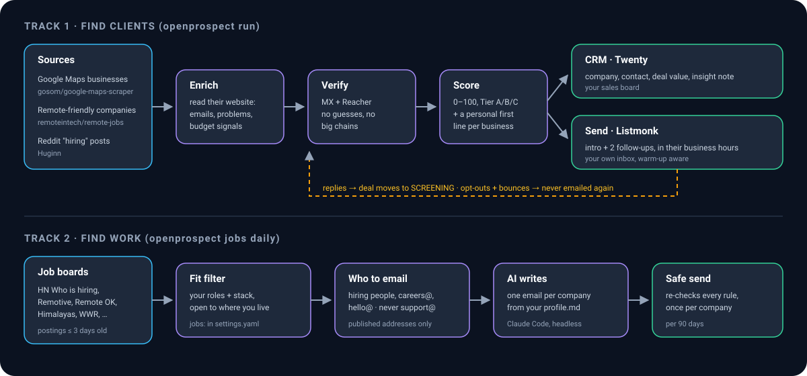

<div align="center">


# OpenProspect

### Your own outbound engine. Find leads, verify them, reach out, and track every reply.

**Self-hosted, open source, and free. For freelancers, agencies and anyone looking for their next client or job.**

[](LICENSE)
[](https://www.python.org/)
[](https://docs.astral.sh/uv/)
[](infra/docker-compose.yml)
[](#why-openprospect)
[](CONTRIBUTING.md)
[](https://github.com/Bhanuteja005/openprospect/stargazers)

[Why](#why-openprospect) · [Features](#features) · [How it works](#how-it-works) · [Quick start](#quick-start) · [Daily use](#your-15-minutes-a-day) · [Commands](#commands) · [Server](#run-it-on-a-server) · [Structure](#repository-structure) · [FAQ](#faq) · [Stars](#star-history) · [Docs](docs/README.md)

<code>git clone https://github.com/Bhanuteja005/openprospect && cd openprospect && bash scripts/install.sh</code>

<br /><br />



</div>

---

OpenProspect finds people who are likely to pay you, works out why they might need you, and sends each one a short, personal, honest email. Everything runs on your own computer or server. It has no monthly fees and no per-contact credits, and your lead list stays on your machine. The one exception is optional: the job track's AI writer sends that day's job postings and your profile to Anthropic through Claude Code.

It has two tracks, and you can use either one or both:

- **Find clients.** It scrapes local businesses from Google Maps, plus remote-friendly companies and Reddit posts from people asking to hire help. It reads each business's website for real problems you could fix, such as a broken security certificate, a slow or non-mobile site, or no online booking. It then verifies the email address, scores the lead from 0 to 100, puts it in a CRM, and sends a 3-email sequence that opens with what it found. Once you switch on automatic sending, each email is scheduled for the business's working hours (US leads: Eastern or Central time).
- **Find work.** It collects fresh remote and freelance job postings that match your skills and location, and finds the right person to email under strict rules. An AI writes each email individually from your own profile, and the email goes out once.

It's the glue code around [seven excellent open-source projects](#credits). Each one does a single job well.

## Why OpenProspect

Paid outreach tools such as Apollo, Instantly or Lemlist are polished. They charge per seat, per contact or per sending inbox, though, and your data lives on their servers. OpenProspect makes a different trade:

|  | OpenProspect | Typical paid outreach tool |
| --- | --- | --- |
| Cost | Free, runs on your own hardware or a small VPS | Monthly subscription, often per seat or per contact |
| Your data | A SQLite file and Docker volumes you own | Stored by the vendor |
| Lead source | Local businesses (Google Maps), remote-friendly companies, Reddit buyer intent, job boards | Usually a large B2B contact database |
| Why each email is relevant | Built from a real, checkable problem found on the lead's own website | Usually templates plus merge fields |
| Setup | One install script, then about 15 minutes of configuration | Sign up and go |
| Support | Community, docs, the source code | Vendor support |

Choose OpenProspect if you sell to small and local businesses, or want to reach companies that are hiring, and you'd rather own the system than rent it.

## Features

### Track 1: find clients (`openprospect run`)

- **Three lead sources.** Google Maps searches you write (`dentist in Austin TX`) or that are generated for you (every niche × every city). Also ~900 remote-friendly companies, and Reddit posts from people asking to hire a developer or marketer.
- **Website audit, passive only.** No website, site down, certificate warning, certificate expiring, old TLS, outdated WordPress / PHP / jQuery, no https redirect, mixed content, not mobile-friendly, slow, old copyright year, no online booking, low Google rating. It also records budget signals: ad pixels, analytics and paid booking tools.
- **Email verification before anything is sent.** It checks MX records and runs Reacher mailbox checks. When port 25 is blocked, it falls back to accepting only addresses published on the business's own site. Big chains are detected and skipped.
- **A 0–100 score with tiers A/B/C.** The score combines category value, review volume, rating, price level, budget signals, fixable problems and reachability. It tells you who to call first.
- **A personal first line for every business.** It's built from the biggest problem found, with an optional local-AI version through Ollama.
- **CRM included.** Each lead becomes a company, a contact, a deal (`Bright Smile Dental - Tier A (82)`, with an estimated value) and an insight note in [Twenty](https://github.com/twentyhq/twenty).
- **Sequences that behave like a person.** You get an intro and two follow-ups, and follow-ups go out first. Daily limits are warm-up aware and capped at 20 emails per hour. Every campaign starts as a draft until you switch on `auto_send`; from then on, each one is scheduled for the lead's business hours (US leads: Eastern or Central).
- **It listens.** A reply stops the sequence, including follow-ups that were already scheduled, and moves the deal to SCREENING. "No thanks" and bounces are suppressed forever.

### Track 2: find work (`openprospect jobs daily`)

- **Fresh postings from 7 public boards.** Hacker News *Who is hiring?* and *Seeking freelancer?*, Remotive, Remote OK, Himalayas, We Work Remotely, Jobicy and Working Nomads.
- **Your fit, your location.** The roles you want, the roles you don't, your stack, and the regions that are or aren't open to you are all set in `settings.yaml`.
- **Strict recipient rules.** Only named hiring people (HR, founders, CTOs) with published evidence, then careers@ or jobs@, then hello@, then a general inbox such as info@ or team@ when nothing better exists. Never support@, billing@ or noreply@, and never a guessed address: at send time, every address must be one the scraper found or appear on the page the writer cites.
- **One email at a time.** [Claude Code](https://claude.com/claude-code) researches each company and writes from `config/profile.md` and a cold-email guide. You can also write `drafts.json` yourself or with any other tool.
- **Safe sending.** Every recipient is re-checked before sending, MX is verified, one email per company per run, and the same company is never emailed twice within 90 days. Sending stops cleanly at your provider's daily limit. There is no warm-up in this track, so keep `jobs.max_companies_per_day` low (20–30) on a new inbox.

## How it works

`openprospect run` does the whole agency track. Every step is isolated, so a failure in one step never stops the rest. Only one run can happen at a time, and each run is logged to `data/logs/`.

1. **Replies, bounces, opt-outs.** Reads your inbox over IMAP, stops sequences and updates the CRM.
2. **Send emails (leads ready from earlier runs).** Follow-ups and yesterday's leads go first, so email always goes out even if scraping runs long.
3. **Google Maps.** Runs new searches in Docker.
4. **Remote-friendly companies.** Adds up to 50 new ones (skip with `--no-remote`).
5. **Enrich websites.** Reads the homepage and contact/about pages of every new lead.
6. **Verify emails.** Picks the best sendable address and skips chains.
7. **Score leads.** Assigns a score, a tier, a subject and a first line.
8. **Sync CRM.** Pushes leads to Twenty (rate-limit aware).
9. **Buyer intent.** Turns new Reddit "hiring" posts into `INTENT:` deals.
10. **Send emails (new leads, rest of the daily limit).**
11. **Export.** Writes `data/exports/all_leads.csv`, then prints a summary.

`openprospect jobs daily` runs the job track: `jobs find` → `jobs write` → `jobs send`. See [docs/job-track.md](docs/job-track.md).

## Quick start

**You need:** [Docker](https://docs.docker.com/get-docker/) (Docker Desktop on Windows/macOS), [uv](https://docs.astral.sh/uv/getting-started/installation/), Git, and about **4 GB of free RAM** for the services. Firecrawl is optional and needs about 4 GB more.

```bash
git clone https://github.com/Bhanuteja005/openprospect
cd openprospect
bash scripts/install.sh                                        # Linux / macOS
# powershell -ExecutionPolicy Bypass -File scripts\install.ps1   # Windows
```

The install script runs these steps for you. You can also run them by hand:

```bash
uv sync                          # install every package into .venv
uv run openprospect init         # .env with random passwords + config/ from the examples
#   edit config/settings.yaml    -> your name, intro, website, postal address (required), what you offer
uv run openprospect up           # start the CRM, email sender, verifier, intent watcher (first time ~6 GB)
uv run openprospect setup        # Listmonk API user + safe sending speed, Huginn scenario
```

Then connect the two things only you can provide:

1. **Your sending inbox.** In `.env`, set `SMTP_USER`, `SMTP_PASSWORD`, `FROM_EMAIL` and the same for `IMAP_*`. For Gmail, use an [app password](https://myaccount.google.com/apppasswords). Then run `uv run openprospect setup` again.
2. **Your CRM key.** Open http://localhost:3740, create your account (it only exists on your machine), go to **Settings → APIs & Webhooks → Create API key** (if you don't see *APIs & Webhooks*, turn on **Advanced mode** in Settings first), and paste it into `.env` as `TWENTY_API_KEY`.

Check everything, then do your first run:

```bash
uv run openprospect doctor       # every line should say OK (Firecrawl, port 25 and Claude Code may show --)
uv run openprospect run          # the first run creates email campaigns as DRAFTS
```

Open http://localhost:3741/admin/campaigns, read a draft and press **Start**. Once you trust it, set `sending.auto_send: true` and schedule the daily run. The full walkthrough is in [docs/getting-started.md](docs/getting-started.md).

## Your 15 minutes a day

1. **Twenty → Opportunities → SCREENING column.** These people replied. Answer them and book the call.
2. **Deals named `INTENT: …`.** Open the note, click the Reddit link and reply yourself, fast. The first reply usually wins.
3. **Tier A deals with only a phone number.** Call them; they're often the best leads.
4. **Move deals along** as they progress: MEETING → PROPOSAL → CUSTOMER.
5. **Job track:** skim `data/jobs/daily/<today>/drafts.json` if you want to see what went out.

To schedule both tracks, run `bash scripts/schedule-cron.sh --install` on Linux/macOS or `scripts\schedule-windows.ps1` on Windows. On a server, use `openprospect daemon`.

## Commands

Run as `uv run openprospect <command>` (or `openprospect <command>` inside the activated `.venv`). Add `--help` to any command for details.

| Command | What it does |
| --- | --- |
| `init` | Create `.env` (random passwords) and `config/` from the examples. Never overwrites. |
| `up` · `up --firecrawl` · `down` | Start / stop the services in Docker |
| `setup` | One-time: Listmonk API user, SMTP + sending speed, Huginn buyer-intent scenario |
| `doctor` | Check the workspace, every service, every connection, port 25 |
| **`run`** | **The daily agency job: all 11 steps above** (`--no-remote` to skip remote companies) |
| `daemon` | Stay running and start each track daily at the times in `settings.yaml` |
| `scrape` · `scrape --all` | Google Maps: new searches only, or re-run every line of `queries.txt` |
| `remote [N]` | Add N remote-friendly companies |
| `enrich` · `verify` · `score` · `crm` · `intent` · `replies` · `send` | Run one step on its own |
| `score --all` | Re-score everything after you edit `settings.yaml` |
| `prep` | Enrich + verify + score + CRM + intent, with no scraping and no sending |
| `stats` | Totals and the top 10 leads |
| `export [FILE]` | All leads to CSV (default `data/exports/leads_<time>.csv`) |
| `import-csv FILE` | Load a CSV exported from the Google Maps scraper's web UI |
| `jobs find` · `jobs write` · `jobs send [--dry-run]` · `jobs daily` | The job track, step by step or all at once (`--day YYYY-MM-DD`) |

## Configuration

You edit four files. All four are git-ignored and created by `init` (the first three from the examples next to them):

| File | What's in it |
| --- | --- |
| `config/settings.yaml` | Who you are, what you offer, what to scrape, scoring, sending limits, schedule, job-track filters |
| `config/queries.txt` | One Google Maps search per line (`roofing contractor in Denver CO`), each scraped once |
| `config/profile.md` | Your story and proof for the job track's AI writer |
| `.env` | Service URLs, passwords, your SMTP/IMAP inbox, API keys |

The email wording lives in `templates/emails/*.html`. Every setting is explained in [docs/configuration.md](docs/configuration.md).

## Run it on a server

On a small VPS (4 vCPU / 8 GB recommended), the whole thing runs in Docker, the daily jobs included:

```bash
uv run openprospect init && nano config/settings.yaml .env
echo "OPENPROSPECT_HOST_DATA_DIR=$(pwd)/data" >> .env
docker compose -f infra/docker-compose.yml --env-file .env --profile runner up -d
```

Always pass `--env-file .env`. Without it, Compose looks for `infra/.env` and starts the databases with blank passwords. The `runner` profile starts the `openprospect daemon` container, which runs both tracks at `schedule.agency_time` and `schedule.jobs_time` in the container's time zone (`TZ` in `.env`, UTC by default). Every port is published on `127.0.0.1` only. Reach the web UIs through an SSH tunnel or a reverse proxy with authentication, and keep the server's firewall closed to the service ports (Reacher has no login at all). Ports, reverse proxies, `TWENTY_SERVER_URL`, backups and sizing are covered in [docs/deployment.md](docs/deployment.md).

## Repository structure

OpenProspect is a [uv workspace](https://docs.astral.sh/uv/concepts/projects/workspaces/) monorepo. There is one lockfile and one virtualenv. Every package shares the `openprospect.*` namespace (`from openprospect.core import db`).

```text
openprospect/
├── apps/
│   └── cli/                 the `openprospect` command: parsing, the daily pipeline, doctor/stats/export, daemon, Dockerfile
├── packages/
│   ├── core/                paths, .env + settings.yaml, the SQLite lead store, text helpers
│   ├── sources/             Google Maps, remote-friendly companies, Reddit buyer intent
│   ├── enrich/              website reader, signals, fixable problems ("pain points")
│   ├── verify/              MX checks, Reacher, chain detection
│   ├── scoring/             0-100 score, tiers, the first line + subject of each email
│   ├── mail/                Listmonk sequences, IMAP replies/bounces/opt-outs, plain SMTP
│   ├── crm/                 Twenty CRM client + sync
│   └── jobs/                the job & freelance track
├── infra/                   docker-compose.yml (all services) + the Huginn scenario
├── config/                  *.example files; your own copies live next to them (git-ignored)
├── templates/emails/        the 3 sequence emails (HTML)
├── prompts/                 the AI writer's instructions + cold-email writing guide
├── scripts/                 install + schedule scripts for Linux/macOS/Windows
└── docs/                    everything else you might want to read
```

How the packages depend on each other. `core` depends on nothing, and only `apps/cli` wires steps together:

```text
                      apps/cli
   ┌───────┬────────┬───────┼────────┬────────┬───────┐
sources  enrich  verify  scoring   mail     crm    jobs
   │                                 │              │
   └──────────── crm ────────────────┘    mail + verify
                      every package → core
```

Each package has its own README (for example [packages/enrich](packages/enrich/README.md)). The design is explained in [docs/architecture.md](docs/architecture.md).

## Responsible use

B2B cold email is allowed in many countries, under conditions: it has to be relevant, honest, identify you and be easy to stop. Some recipients need consent first, for example sole traders in the UK (PECR) and anyone in Canada (CASL). Read [docs/responsible-use.md](docs/responsible-use.md) before choosing your markets. OpenProspect is built for the cautious path:

- Nothing is sent until you set your postal address, and every email carries it.
- Every email offers an opt-out by reply. Opt-outs and bounces are never emailed again.
- Volumes stay human, and nothing is sent automatically until you switch it on.
- Reddit posts are never answered automatically.

You are still responsible for following the law where you and your recipients are. This is not legal advice.

## FAQ

<details>
<summary><b>Does it really cost nothing?</b></summary>

All the software is free and open source. What you might pay for: a sending domain (about $10/year, recommended so your main domain's reputation is never at risk), a VPS if you don't want to run it on your own computer, and optionally a Claude subscription for the job track's AI writer.
</details>

<details>
<summary><b><code>doctor</code> says port 25 is blocked. Is that a problem?</b></summary>

No. Most home and many cloud networks block outbound port 25, which Reacher needs for its deep mailbox check. OpenProspect then switches to a free fallback: the address must be published on the business's own website, and its domain must have a working mail server. Guessed addresses (`info@…`) are only used when Reacher can confirm them, so they're skipped on blocked networks.
</details>

<details>
<summary><b>Can I send from a free Gmail account?</b></summary>

Yes for testing and small volumes, using an app password. For real volume, use a separate domain with Google Workspace or Zoho. New inboxes get blocked when they send too much too soon, so keep the warm-up settings (`sending.warmup_*`) and a modest `daily_limit`.
</details>

<details>
<summary><b>Do I need Claude?</b></summary>

Only for `jobs write`, the job track's AI writer. The agency track doesn't need it, and its first lines come from templates (or from a free local model through Ollama). For the job track you can also write `drafts.json` yourself or with any tool; the format is in [docs/job-track.md](docs/job-track.md).
</details>

<details>
<summary><b>Windows, macOS or Linux?</b></summary>

All three. Everything is Python plus Docker. There are install and schedule scripts for both shells, and the `runner` profile runs it all in containers on a Linux server.
</details>

<details>
<summary><b>Isn't scraping Google Maps against Google's terms?</b></summary>

Google's terms don't allow automated scraping. Keep volumes modest (the defaults are), don't run it around the clock, and decide for yourself whether it fits your situation. You can also import a CSV you collected another way with `import-csv`.
</details>

<details>
<summary><b>How many leads a day?</b></summary>

With the defaults (15 searches, depth 2), expect a few hundred places per run. How many end up with a sendable email depends on the niche and country. Sending is limited by `sending.daily_limit`, not by scraping.
</details>

## Documentation

| Guide | |
| --- | --- |
| [Getting started](docs/getting-started.md) | From clone to first email, step by step |
| [Configuration](docs/configuration.md) | Every setting in `settings.yaml` and `.env` |
| [Architecture](docs/architecture.md) | Packages, data flow, the lead lifecycle, extending it |
| [Job track](docs/job-track.md) | Finding remote and freelance work |
| [Deployment](docs/deployment.md) | Servers, the runner container, backups, scheduling |
| [Troubleshooting](docs/troubleshooting.md) | When something doesn't work |
| [Responsible use](docs/responsible-use.md) | The law, deliverability, the safeguards |

## Contributing

Contributions are welcome: new lead sources, new pain points, new job boards, translations of the email templates, docs and bug fixes. Start with [CONTRIBUTING.md](CONTRIBUTING.md). It covers the dev setup (`uv sync`, `uv run pytest`, `uv run ruff check .`) and the package boundaries. Please also read the [Code of Conduct](CODE_OF_CONDUCT.md), and report security issues privately as described in [SECURITY.md](SECURITY.md).

## Credits

OpenProspect stands on the shoulders of these projects. Please star them too.

| Project | Its job in OpenProspect |
| --- | --- |
| [gosom/google-maps-scraper](https://github.com/gosom/google-maps-scraper) | Scrapes businesses from Google Maps: name, phone, website, rating, reviews, emails |
| [huginn/huginn](https://github.com/huginn/huginn) | Watches Reddit every hour for people asking to hire help |
| [firecrawl/firecrawl](https://github.com/firecrawl/firecrawl) | Optional: reads JavaScript-heavy sites and sites that block simple requests |
| [reacherhq/check-if-email-exists](https://github.com/reacherhq/check-if-email-exists) | Checks that an inbox exists before anything is sent |
| [remoteintech/remote-jobs](https://github.com/remoteintech/remote-jobs) | ~900 remote-friendly companies as B2B leads |
| [knadh/listmonk](https://github.com/knadh/listmonk) | Sends the email sequence through your own inbox, at a safe speed |
| [twentyhq/twenty](https://github.com/twentyhq/twenty) | The CRM: every lead, deal, stage and note on one board |

The job track reads public data from Hacker News (Algolia API), Remotive, Remote OK, Himalayas, We Work Remotely, Jobicy and Working Nomads. AI writing uses [Claude Code](https://claude.com/claude-code), and optional local first lines use [Ollama](https://ollama.com).

## Star history

If OpenProspect finds you a client or a job, a star helps the next freelancer find it too.

<a href="https://www.star-history.com/#Bhanuteja005/openprospect&Date">
  <picture>
    <source media="(prefers-color-scheme: dark)" srcset="https://api.star-history.com/svg?repos=Bhanuteja005/openprospect&type=Date&theme=dark" />
    <source media="(prefers-color-scheme: light)" srcset="https://api.star-history.com/svg?repos=Bhanuteja005/openprospect&type=Date" />
    
  </picture>
</a>

## License

[MIT](LICENSE). Use it, change it, ship it. Each service in `infra/` keeps its own license.
